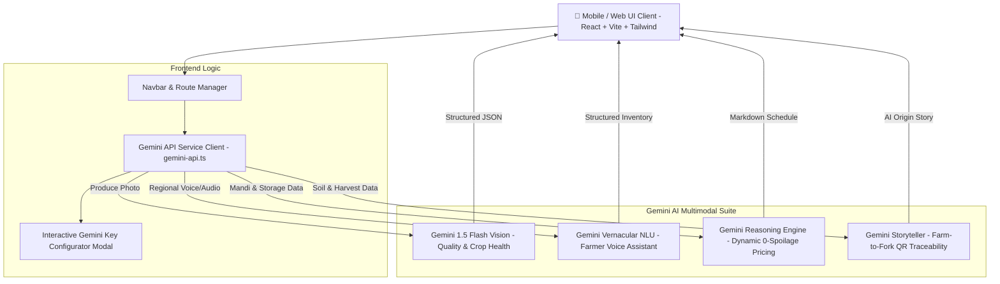

# 🌿 AgriFresh (0-Spoilage Platform) 🤖⚡
### *PS Open Innovation Hackathon • Powered by Google Gemini API*


> **AgriFresh** is a next-generation farm-to-table agricultural supply-chain platform built for the **PS Open Innovation Hackathon**. Powered by Google Gemini’s multimodal vision, audio vernacular NLU, and structured reasoning engines, AgriFresh eliminates post-harvest crop loss, protects farmer incomes, and delivers complete farm-to-fork transparency.

---

## 🚀 High-Impact Gemini API Features

AgriFresh implements 5 core multimodal Gemini capabilities tailored for agricultural logistics and food waste elimination:

### 1. 📸 Visual Quality & Ripeness Grading (Computer Vision)
* **How it works:** Farmers or quality checkers upload or snap a photo of harvested produce (e.g., tomatoes, apples, mangoes, leafy greens).
* **Gemini Integration:** Uses `gemini-1.5-flash` multimodal vision input with structured JSON output to:
  * Estimate ripeness percentage (0–100%).
  * Detect surface scarring, blemishes, or fungal spots.
  * Categorize produce commercial grade (**Grade A Export** / **Grade B Market** / **Grade C Processing**).
  * Estimate shelf-life in days and specify precise cold storage temperature/humidity rules.

### 2. 🎙️ Multilingual Vernacular Voice Assistant for Farmers
* **How it works:** Regional farmers can skip complicated app forms and list harvests using natural voice speech in regional Indian languages (**Hindi**, **Marathi**, **Telugu**, **Tamil**, **Kannada**, **English**).
* **Gemini Integration:** Processes natural speech input to extract structured inventory metadata:
  * Produce name & quantity (kg / quintals).
  * Harvest date & expected rate (₹/kg).
  * Farm location & nearest cold storage hub assignment.
  * Generates an encouraging audio/text confirmation in the farmer's spoken dialect.

### 3. 📈 Dynamic Freshness-Based Pricing & Inventory Markdown Engine
* **How it works:** Multi-parameter AI pricing model that balances Mandi wholesale price benchmarks, time since harvest, storage conditions, and regional demand.
* **Gemini Integration:** 
  * Recommends a **Fair Farm-Gate Payout Rate** for growers (+15% to 20% above traditional middleman rates).
  * Auto-schedules a 4-day progressive consumer discount markdown (Day 0: 0%, Day 1: 15%, Day 2: 35%, Day 3: 60% Flash Sale) to clear inventory before spoilage occurs (Zero Spoilage!).

### 4. 📜 Farm-to-Fork Traceability & Harvest Storyteller
* **How it works:** Consumers scan an on-package QR code or enter a Batch ID.
* **Gemini Integration:** Gemini ingests soil health indices (pH, NPK), harvest timestamps, and pesticide-free certifications to generate:
  * An interactive farm origin story written by AI.
  * Nutritional density card & Superfood scorecard.
  * AI Chef recipe pairings.
  * Kitchen storage tips to maximize household shelf life.

### 5. 🔬 Pest & Crop Health Early-Warning Diagnostic Scanner
* **How it works:** Contract growers snap pictures of diseased leaves, stem spots, or soil patches.
* **Gemini Integration:** Gemini identifies probable pathogens (e.g., *Alternaria solani* Early Blight, Nitrogen chlorosis), provides confidence %, severity level (Low to Critical), and prescribes organic bio-remediation protocols (Neem oil, *Trichoderma viride*, Panchagavya).

---

## 🏗️ System Architecture



---

## 🛠️ Tech Stack

* **Frontend:** React 19, TypeScript, Vite, Tailwind CSS, Shadcn UI components, Framer Motion, Lucide Icons.
* **REST API Backend (Node.js):** Express 5, CORS, Embedded persistent JSON database (`data/db.json`), Drizzle ORM schema compatibility, IoT Cold-Chain Telemetry Engine, Role-Based Access Control (RBAC).
* **AI & Smart Contract Engine (Python):** FastAPI, Uvicorn, Pandas, Scikit-learn, Cryptographic SHA-256 Block Ledger (Soil-to-Shelf Provenance), Q10 Biochemical Spoilage Decay Velocity Modeling, Regional Surplus Risk Analytics.
* **AI & Vision:** Google Gemini API (`gemini-1.5-flash`, `gemini-2.0-flash`) with structured JSON schema responses & client-side fallback simulation.
* **State & Data:** TanStack React Query, Wouter Routing, LocalStorage Key Persistence.

---

## ⚡ Quick Start & Backend Execution

### 1. Start the Node.js Express Backend (Port 5000)
The REST API backend runs out of the box with zero external database configuration:
```bash
npm start
# or
node server.js
```
* **API Base URL:** `http://localhost:5000`
* **Health Check:** [http://localhost:5000/healthz](http://localhost:5000/healthz)
* **Persistent Storage:** `data/db.json` (auto-created with pre-seeded demo accounts & batches)

### 2. Start the Python AI & Smart Contract Microservice (Port 8000)
Run the high-performance FastAPI engine for AI spoilage analytics and cryptographic ledger verification:
```bash
py main.py
# or
python main.py
```
* **Interactive OpenAPI Swagger Docs:** [http://localhost:8000/docs](http://localhost:8000/docs)
* **Health Check:** [http://localhost:8000/health](http://localhost:8000/health)

### 3. Run Automated Backend Tests
Verify all 66+ API and AI endpoints across both backends:
```bash
# Test Node.js REST API Suite (45 tests)
npm test
# or
node test-api.js

# Test Python AI & Smart Contract Suite (21 tests)
py test-python-api.py
```

---

## 🔌 API Endpoints Summary

### 🌿 Node.js Express REST API (`server.js` - Port 5000)
| Method | Endpoint | Description |
|---|---|---|
| `GET` | `/healthz` | System diagnostics & feature health status |
| `POST` | `/api/auth/login` | Role-based login (`farmer`, `consumer`, `seller`) |
| `POST` | `/api/auth/register` | New user registration with hashed password |
| `GET` | `/api/auth/me` | Fetch authenticated user profile |
| `GET` | `/api/herbs` | Herb catalog with botanical & regional search |
| `GET` | `/api/herbs/:id` | Detailed herb profile and linked products |
| `GET` | `/api/products` | Marketplace produce with clearance filters |
| `POST` | `/api/products` | List new farm produce |
| `GET` | `/api/supply-chain/batches` | List all tracked harvest batches |
| `GET` | `/api/supply-chain/batches/:batchNumber` | Soil-to-shelf QR code traceability timeline |
| `POST` | `/api/orders` | Place e-commerce purchase order |
| `GET` | `/api/dashboard/stats` | Global agricultural metrics & spoilage prevented |
| `GET` | `/api/dashboard/farmer` | Farmer inventory, yield, and revenue metrics |
| `GET` | `/api/dashboard/consumer` | Consumer purchases, deliveries, recommendations |
| `GET` | `/api/dashboard/seller` | Trader inventory & fulfillment pipeline |
| `POST` | `/api/cold-chain-telemetry/telemetry` | Ingest IoT sensor reading & auto-apply markdowns |
| `POST` | `/api/cold-chain-telemetry/simulate-anomaly` | Simulate reefer temperature breach & alert dispatch |
| `POST` | `/api/ai/predict-spoilage` | Calculate produce shelf-life loss & decay velocity |
| `POST` | `/api/ai/dynamic-pricing` | Calculate fair farm-gate payout & 4-day discount curve |

### 🤖 Python AI & Smart Contract Engine (`main.py` - Port 8000)
| Method | Endpoint | Description |
|---|---|---|
| `GET` | `/health` | Python microservice health & active ledgers |
| `POST` | `/api/predict-spoilage` | Biochemical Q10 decay velocity calculation |
| `POST` | `/api/dynamic-pricing` | Fair farm-gate payout (+18%) & markdown matrix |
| `GET` | `/api/smart-contract/verify/{batch_id}` | Cryptographic SHA-256 block hash validation |
| `POST` | `/api/smart-contract/append` | Append verified stage block to blockchain ledger |
| `GET` | `/api/regional-surplus` | District vegetable production & glut risk analysis |
| `POST` | `/api/telemetry/ingest` | Ingest IoT sensor packet with anomaly threshold |
| `GET` | `/docs` | Interactive Swagger API documentation |

---

## 🏆 PS Open Innovation Submission Details

* **Hackathon Event:** Build With Vexite
* **Track:** PS Open Innovation
* **Theme:** 0-Spoilage Agricultural Supply Chain
* **Repository URL:** [https://github.com/priyanshu-sarjan/0-spoilage-.git](https://github.com/priyanshu-sarjan/0-spoilage-.git)
* **Live Web App:** [https://ai-agent-ps.vercel.app/](https://ai-agent-ps.vercel.app/)

---

*Made with ❤️ & 🤖⚡ for Indian Farmers & Sustainable Food Logistics.*

